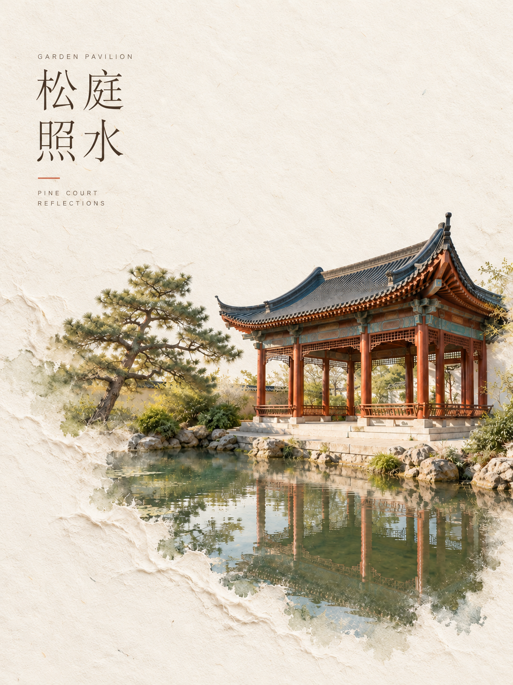
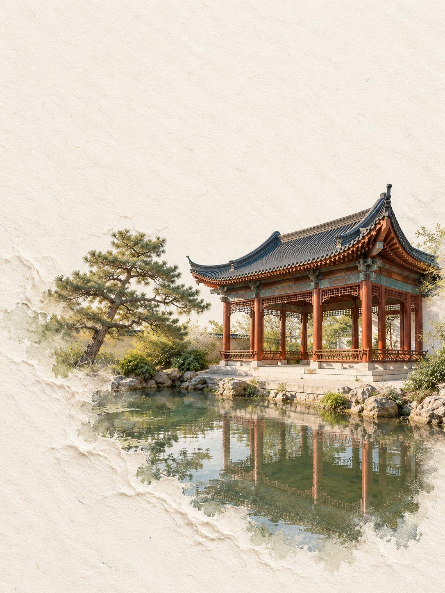
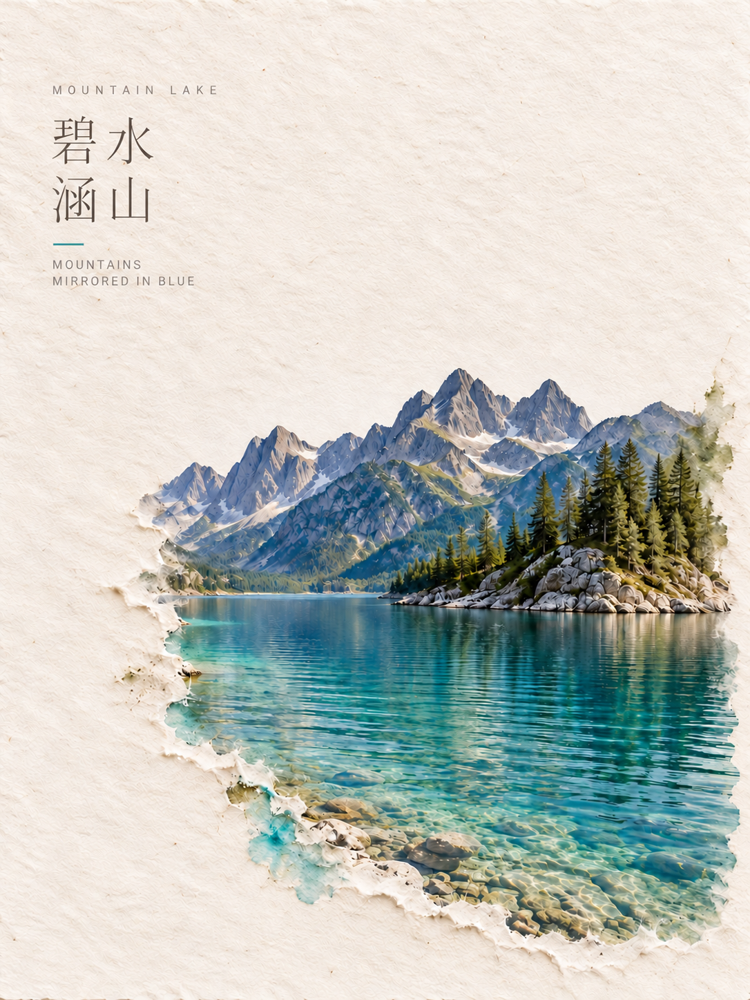
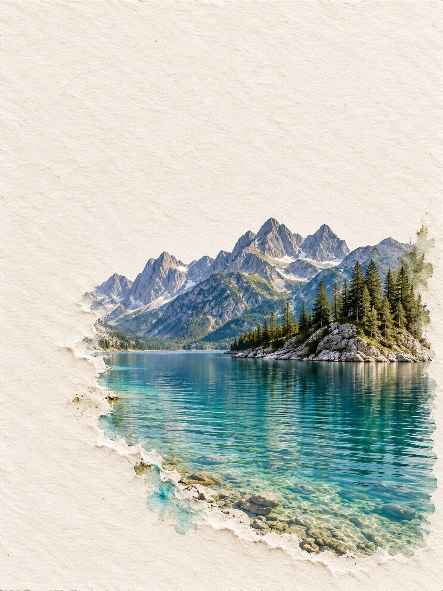

<div align="center">

# 纸境浮绘 · Paper Relief Art

**让影像显于纸，让色彩沁入纤维。**

保留主体，留出空间。<br>
以局部纸浆浅浮雕与淡薄颜料渗染，重新组织一幅照片。

[English](README.md) · [简体中文](README.zh-CN.md)<br>
[安装](#安装) · [两个版本](#选择版本) · [作品与底图](docs/examples.md) · [审美方向](docs/art-direction.md)

</div>

纸境浮绘是一组照片再创作技能：保留可辨认的真实主体，让局部纸纤维、浅起伏与矿物颜料自然交融，周围留下充裕的暖白纸面。可以生成有题名的艺术海报，也可以生成不新增文字的独立艺术图。

## 两个场景，两种呈现

| 有字版 | 无字版 |
| :---: | :---: |
|  |  |
| **松庭照水** | **让图像与纸面完成阅读** |
|  |  |
| **碧水涵山** | **水色沁纸，纤维露白** |

这些场景专为项目示例创作，不是特定地点的纪实摄影。[查看摄影风格底图与示例说明 →](docs/examples.md) 每幅作品分别保存，展示表格只是便于了解两种版本。

## 风格的五个重点

- **主体可信。** 保留关键结构、比例、配色与空间关系，不把主体全部做成厚模型。
- **留白先行。** 竖版海报以约六成安静纸面为起点，依题材与用途调整，避免只留下窄边框。
- **纸浆属于纸面。** 纤维束、浅脊和薄撕片局部生长，柔和侧光只形成细微阴影。
- **颜料浅、少、疏。** 按交界处的相邻景物取色，淡薄色料进入纤维与近旁纸面，染色之间保留明显露白。
- **题名有画面依据。** 从物象、形色、映照或动作提炼古雅短题，比较候选，锁定文字后再排版。

[完整审美方向 →](docs/art-direction.md)

## 选择版本

| 调用名 | 适合用途 |
| --- | --- |
| [`$paper-relief-art-text`](skills/paper-relief-art-text/SKILL.md) | 有题名海报、封面与文化配图；先拟题，再组织纤细中文、可选英文和克制的编辑排版。也可只拟题名。 |
| [`$paper-relief-art-no-text`](skills/paper-relief-art-no-text/SKILL.md) | 无新增排版文字的艺术图、封面底图与配图。建筑匾额等原生文字默认保留。 |

两个技能各自完整，可以只装一个，也可以同时安装；无需额外总入口。

## 安装

### 使用 Skills CLI

需要 Node.js 和 npm。为 Codex 安装两个版本：

```sh
npx skills add Ellventequila/paper-relief-art --agent codex --global --skill paper-relief-art-text paper-relief-art-no-text
```

只安装无字版：

```sh
npx skills add Ellventequila/paper-relief-art --agent codex --global --skill paper-relief-art-no-text
```

此命令使用独立的 [Skills CLI](https://github.com/vercel-labs/skills)。为其他兼容代理安装时，可选择它支持的 `--agent`；安装成功不等于该软件拥有图像生成能力。

### 手动安装

1. 点击仓库 **Code → Download ZIP** 下载，或克隆仓库。
2. 将 `skills/` 中需要的完整技能文件夹复制到技能目录；`SKILL.md`、`agents/` 和 `references/` 必须一起保留。
3. 当前 Codex 的用户级本地技能目录为 `~/.agents/skills/`；Windows 对应 `%USERPROFILE%\.agents\skills\`。若客户端另有技能目录设置，使用其配置位置。避免在多个扫描目录重复安装同名技能。
4. 如果技能没有出现，重新打开会话。

位置与发现方式参见[官方 Codex 技能文档](https://developers.openai.com/codex/skills/)。更新前先保留自己的本地定制。

## 开始使用

上传照片后，按需要调用。

**无字配图**

```text
用 $paper-relief-art-no-text 把这张照片做成3:4纸浆浅浮雕艺术图。
保留主体，留出充裕纸面，边缘颜料淡薄、稀疏。不新增文字。
```

**有字海报**

```text
用 $paper-relief-art-text 处理这张照片，做成3:4艺术海报。
从可见画面拟一个古雅、自然的中文短题，配更小的英文意译。
文字轻盈，纸面疏朗，边缘颜料浅、少、疏。
```

**固定题名，只要中文**

```text
用 $paper-relief-art-text 处理照片，题名固定为“松庭照水”。
只要中文，不要英文、编号或说明；保留主体与大面积留白。
```

**只拟题名，不生成图**

```text
用 $paper-relief-art-text 为这张照片拟3个中文题名，分别给一句画面依据。
本次不生成图片。
```

可以指定横幅、方形、输出目录、只要标题或彻底无字。明确要求始终优先于默认设置。“无字版”默认不新增排版文字；需要删去原生匾额、标签等时，请明确说“任何字都不要”。

## 如何工作

查看素材 → 提炼主体与必须保留的关系 → 安排主体与留白 → 选择少数纸浆交融位置 → 按相邻景物取色并控制渗染。有字版再经过候选题名比较、逐字锁定与编辑排版。成图后分别检查主体、材料、留白和文字，集中修正主要问题。

内部规则分别放在[材料与构图](skills/paper-relief-art-text/references/art-direction.md)、[提示词组织](skills/paper-relief-art-text/references/prompt-guide.md)和[题名筛选](skills/paper-relief-art-text/references/title-writing.md)中。规则以中文编写，可以用中文或英文提出请求。

## 使用条件与边界

需要能查看图片、生成或编辑图片的代理环境。这些技能提供审美方向与工作流程，不自带图像模型、渲染服务或 API。只有文字能力的软件可以准备题名与提示词，不能仅靠安装技能生成成图。

展示作品在具备图像编辑能力的环境中完成。输出会随工具和素材变化；中文排版、主体保持需要实际看图检查，修订不保证逐像素一致。没有声称所有代理软件都通过了成图测试。

本项目用于视觉再创作，不能替代纪实摄影修复。请使用有权改作、展示的素材。技能本身不要求另装运行库。

## 参与完善

欢迎提交中文或英文反馈。提供可公开使用的素材、请求内容、结果与具体偏差，会更便于复现问题。见[参与说明](CONTRIBUTING.md)和[题名检验案例](tests/title-cases.md)。

如果这些规则帮到了你的创作，可以点一颗 Star，让更多人发现它。改善真实成图的规则与案例尤其欢迎。

## 许可

技能、脚本和文档采用 [MIT 许可证](LICENSE)。`assets/examples/` 下的图片不包含在 MIT 授权范围内，仅用于效果展示，详见[图片使用说明](assets/examples/README.md)。
