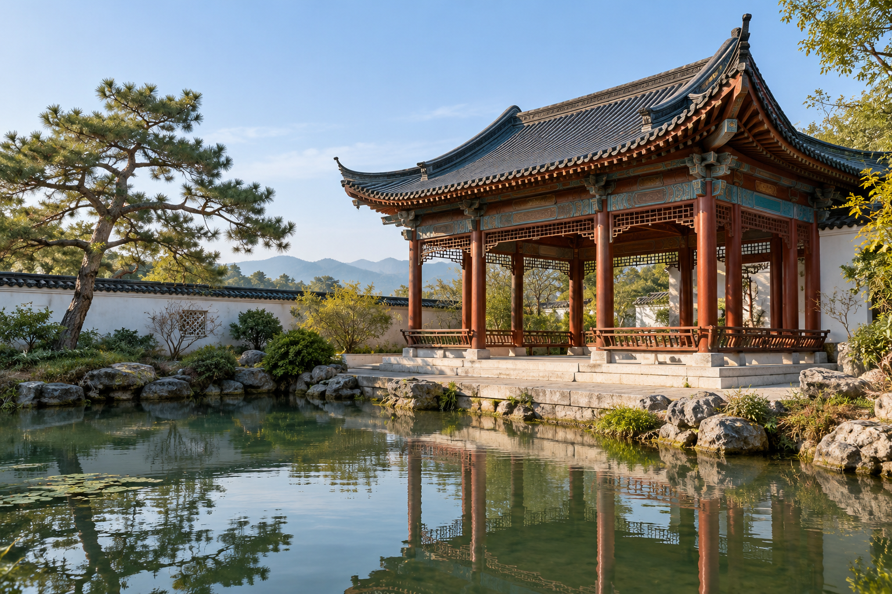
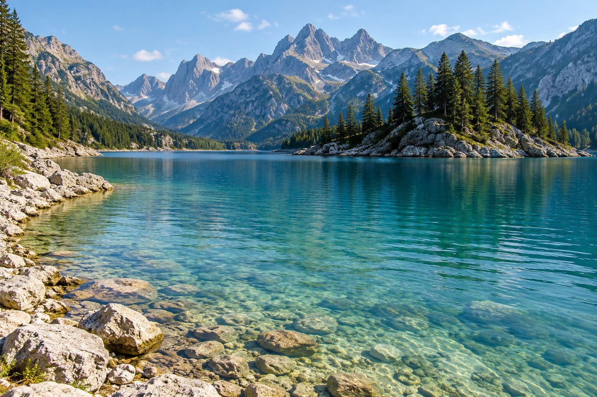

# Examples · 作品与底图

Two purpose-made photographic-style scenes form these examples. They are imagined scenes, not documentary photographs of named locations.

## Pine Court Reflections · 松庭照水

The source contains a timber pavilion, pine, and their pond reflections. The transformation preserves those relationships, reduces surrounding clutter, replaces the sky with quiet paper, and brings pale local green and warm red into selected fiber openings.

| With text | Without added text |
| :---: | :---: |
|  |  |

“松庭照水” draws from the pine courtyard and its visible water reflection. The English title is “Pine Court Reflections.” No named location, author, date, or fictional series number is added to the artwork.

## Mountains Mirrored in Blue · 碧水涵山

The source contains distinctive gray peaks, a pine peninsula, and clear blue-green water. The artwork keeps those features, removes the sky and excess foreground, and gives the scene a smaller lower-right footprint. Pale green follows nearby trees; turquoise follows nearby water.

| With text | Without added text |
| :---: | :---: |
|  |  |

“碧水涵山” comes from the clear water holding the mountain scene and its reflections. The English interpretation is “Mountains Mirrored in Blue.”

## Reading the examples

These examples show the intended visual direction, not a guaranteed output. Generation and text-only revisions can also alter local image detail. Inspect subject structure and materials alongside the title rather than assuming a precise pixel match.

底图与成图均为本项目专门创作的示例，不用于证明特定地点的真实面貌。四幅艺术图独立保存；有字、无字展示的是两个技能的不同用途。图像转换与排版修订可能改变局部细节，不能视为逐像素保真的承诺。

Images are separate from the software/documentation license. See [image usage](../assets/examples/README.md).
